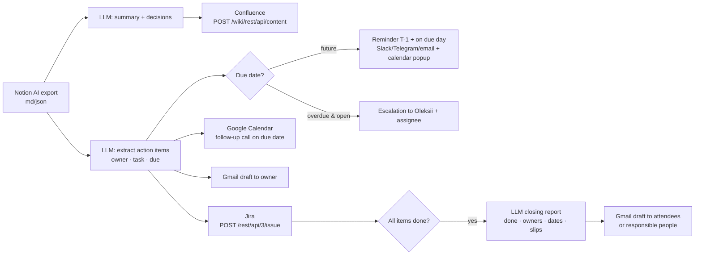

# meeting-ops-pipeline

Automates the PM routine that follows every meeting: **Notion AI meeting notes → LLM summary → Confluence page → action items → Jira tasks + follow-up calls + email drafts + reminders/escalations → closing report to stakeholders once everything is done.**

Dry-run by default: every external call is recorded with the real REST API shape (Confluence, Google Calendar, Gmail drafts, Jira, Slack/Telegram) and **nothing is sent**.



## Run
```bash
python -m venv .venv && . .venv/bin/activate && pip install pytest openai
python run.py            # dry-run demo, writes out/*.json
python -m pytest -q      # offline tests
RUN_LIVE=1 python -m pytest tests/test_live_evals.py   # evals against the real model
LLM_MODE=mock python run.py   # offline; real LLM is the default when OPENAI_API_KEY or GEMINI_API_KEY is set
```
Options: `Pipeline(today, dry_run=True, stakeholders="attendees"|"responsible", channel="slack"|"telegram"|"email")`.

## Production hardening (see [docs/iterations.md](docs/iterations.md))
- Real LLM by default (Gemini via OpenAI-compatible endpoint, model fallback chain), per-step trace with tokens/cost in `out/llm_trace.json`.
- Input validation of the export; relative deadlines in UA/EN resolved by deterministic rules ("до наступної п'ятниці", "end of next week", "ASAP"); owners resolved to attendees with aliases, ambiguous ones sent to Oleksii for clarification.
- Prompt-injection defence: notes are untrusted data; items touching outside addresses are held for review. Confluence body is escaped.
- Idempotent re-ingestion, business-day reminders, owner emails in the item's language, closing report grounded in computed facts and validated.

## Outputs
- `out/run_output.txt` – console run · `out/run_result.json` – per-item Jira key, calendar event, draft, reminders
- `out/llm_trace.json` – which model answered each step, tokens, cost
- `out/api_calls_dry_run.json` – every request that *would* be sent · `out/closing_report.json`

## How I used this in real projects
In my delivery work I automated about 90% of the PM routine — status reports, plans, meeting summaries and follow-ups — with AI tools and by delegating to the right people. What remained for me was live communication: talking to clients and the team. The teams were set up to be autonomous, covering the basics without me hovering over them. This repo is a clean, generic reconstruction of that workflow, built on sample data.
